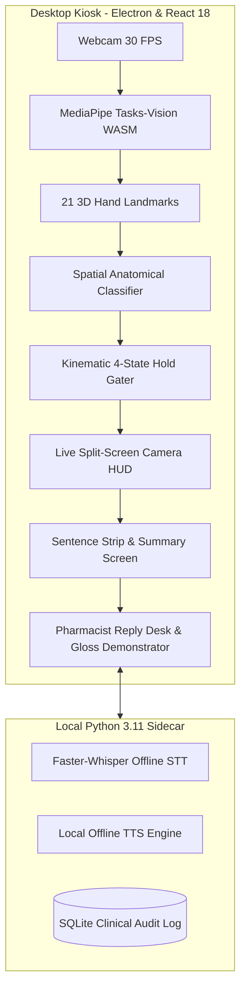

# GESTURA: Offline Pharmacy Sign-Language Kiosk Aid

[](https://github.com/)
[](https://github.com/)
[-brightgreen.svg)](https://github.com/)
[](LICENSE)

> **Academic Capstone Project**: CSA1023 Software Engineering  
> **Student**: Karthik Harish  
> **Institution**: SIMATS School of Engineering (Department of Computer Science & Engineering)  
> **Presentation / Viva Date**: 27 November

---

## 📌 Project Overview

**GESTURA** is an offline, privacy-first, bidirectional communication kiosk engineered specifically for non-urgent pharmacy and outpatient counters. It bridges the critical barrier between Deaf / Hard-of-Hearing (D/HH) patients and community pharmacists on a single counter workstation without requiring internet access or cloud services.

### Core Value Proposition
- **100% Offline & Zero-Cloud**: Operates completely disconnected from the internet. Camera video frames never leave memory, guaranteeing HIPAA/GDPR clinical privacy compliance.
- **Bi-Directional Communication**:
  - **Patient $\rightarrow$ Pharmacist**: Real-time webcam sign recognition across **15 locked pharmacy signs**, progressive hold ring indicator, live sentence strip, and 2-meter legible summary.
  - **Pharmacist $\rightarrow$ Patient**: Clean prescription desk with quick clinical phrases ("Take with water", "Morning and night", "After food"), high-contrast animated sign gloss sequences, and text-to-speech.
- **Robust Multi-Modal Kinematics**:
  - **4-State Hold Gater**: State machine (`NO_HAND` $\rightarrow$ `DETECTING` $\rightarrow$ `CONFIRMED` / `UNSURE`) with 6–10 frame hold window and 800ms commit lock to eliminate false triggers from incidental hand repositioning.
  - **Screen-Space Hand Separation**: Anatomical `x0 < x1` screen coordinate partitioning to guarantee accurate two-hand coordination independent of MediaPipe handedness inversions.
  - **Fallback Keyboard / Touch Tray**: Accessibility tray allowing immediate 1-click chip or text entry if a patient has hand tremor, partial limb paralysis, or low dexterity.

---

## 🖐️ Locked Pharmacy Vocabulary (15 Signs)

Every sign was chosen based on community pharmacy prescription consultations:

| # | Sign Gloss | Category | Hand Shape & Anatomical Posture | Primary Use Case |
|---|------------|----------|---------------------------------|------------------|
| 1 | `HEADACHE` | Symptom | Index finger touching/pointing near temple / forehead | Reporting tension headache or migraine |
| 2 | `STOMACH-PAIN` | Symptom | Open palm or gentle fist pressed over abdominal area | Requesting antacid or gastrointestinal relief |
| 3 | `FEVER` | Symptom | Back of flat palm pressed against forehead | Inquiring about antipyretics (paracetamol) |
| 4 | `COUGH` | Symptom | Curved C-hand or loose fist covering mouth/throat | Inquiring about cough syrup / expectorant |
| 5 | `COLD` | Symptom | Both hands clenched shivering near chest / collarbone | Describing flu, nasal congestion, or chills |
| 6 | `ALLERGY` | Symptom | Index scratch across opposite forearm / back of hand | Requesting antihistamines or skin ointments |
| 7 | `DIZZY` | Symptom | Open hand making circular rotation above head | Reporting vertigo, imbalance, or lightheadedness |
| 8 | `NAUSEA` | Symptom | Open flat palm gently circling stomach/chest area | Describing sickness or motion sensitivity |
| 9 | `VOMITING` | Symptom | Open palm moving forward and downward from mouth | Describing acute upset stomach or vomiting |
| 10 | `DIARRHEA` | Symptom | Flat base hand with downward pulling motion | Requesting rehydration salts or anti-motility aid |
| 11 | `WATER` | Instruction | "W" handshape (Index, Middle, Ring extended; pinky folded) near chin | Asking to take medication with water |
| 12 | `FOOD` | Instruction | Flat-O bundled fingertips tapping lips / mouth | Asking about food/meal timing with tablets |
| 13 | `MORNING` | Timing | Flat palm rising from horizontal base (sunrise gesture) | AM dosage schedule |
| 14 | `NIGHT` | Timing | Curved dominant hand draping over base wrist (sunset gesture) | PM / bedtime dosage schedule |
| 15 | `THANK-YOU` | Social | Flat open palm touching chin and extending forward | Polite closing of counter interaction |

---

## 🏛️ System Architecture



- **Frontend / Kiosk Shell**: Electron 28+, Vite 5, React 18, TypeScript, TailwindCSS, Lucide Icons, Zustand State Store.
- **Vision & Kinematics**: MediaPipe `@mediapipe/tasks-vision` (WebAssembly & WebGL), 21-joint 3D hand tracking, screen-space relative coordinates.
- **Backend Sidecar**: Python 3.11, FastAPI, `faster-whisper` (int8 quantized local models), Alembic migrations, SQLite.

---

## 🚀 Quick Start Guide

### Prerequisites
- Node.js 18+ (LTS recommended)
- Python 3.11 (for local sidecar)
- Git

### 1. Clone the Repository
```bash
git clone https://github.com/<your-username>/Gestura.git
cd Gestura
```

### 2. Install Dependencies
```bash
# Install frontend workspace dependencies
npm install

# Setup Python virtual environment
python -m venv .venv
.\.venv\Scripts\Activate.ps1
pip install -r requirements.txt
```

### 3. Run in Development Mode
```bash
# Launch Electron desktop kiosk with Hot Module Replacement
npm --workspace=apps/desktop run dev
```

### 4. Build Standalone Production Executable
```bash
npm --workspace=apps/desktop run build
```
The compiled Windows standalone package will be generated at `apps/desktop/release/win-unpacked/GESTURA.exe`.

---

## 🧪 Verification & Test Suite

All tests can be executed locally offline:

```bash
# 1. Run all 57 Desktop Frontend & Kinematics Unit Tests
npm --workspace=apps/desktop test

# 2. Run all 54 Python Sidecar & Model Pipeline Tests
.\.venv\Scripts\pytest.exe tests -q

# 3. Run Playwright End-to-End Clinical Verification
npx playwright test tests/e2e/pharmacyFlow.spec.ts -c apps/desktop/playwright.config.ts
```

**Results**: 111 passing tests across all layers (0 failures).

---

## 📂 Project Structure

```
Gestura/
├── apps/
│   ├── desktop/                 # Electron + Vite + React 18 Desktop App
│   │   ├── src/
│   │   │   ├── main/            # Electron main process & IPC handlers
│   │   │   └── renderer/        # React UI & Pharmacy Kiosk Screens
│   │   │       ├── components/pharmacy/  # Home, Sign, Summary, Reply, Practice, History
│   │   │       ├── recognition/          # SpatialSignClassifier & PharmacyHoldGater
│   │   │       ├── config/               # Locked 15 Pharmacy Signs definition
│   │   │       └── er/                   # Emergency Department ontology & state
│   │   └── tests/               # Vitest unit tests & Playwright E2E suites
│   └── web/                     # Lightweight web preview & docs
├── docs/                        # Capstone project report & academic papers
├── figures/                     # High-res architecture & ML pipeline diagrams
├── ml/                          # PyTorch 1D-TCN training scripts, ONNX exports & weights
├── services/
│   └── sidecar/                 # FastAPI offline microservice (STT/TTS/Glosses)
└── README.md
```

---

## 🎓 Academic viva / Project Submission

- **Student Name**: Karthik Harish
- **Course**: CSA1023 Software Engineering
- **Institution**: SIMATS School of Engineering
- **Primary Guide / Evaluator**: SIMATS CSE Faculty Board
- **Full Capstone Report**: Available in [`docs/CAPSTONE_PROJECT_REPORT.md`](docs/CAPSTONE_PROJECT_REPORT.md) and formatted Word document [`docs/GESTURA_Capstone_Project_Report.docx`](docs/GESTURA_Capstone_Project_Report.docx).
