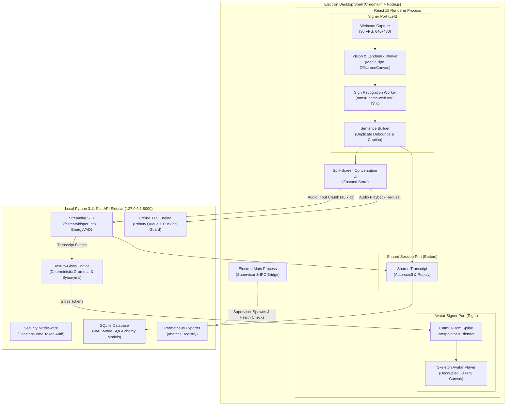

# GESTURA System Architecture & Design Specification

## 1. High-Level System Architecture

GESTURA is an offline, single-device, bidirectional sign-language communication app that bridges Deaf/hard-of-hearing signers and hearing communication partners across a split-screen interface on a single laptop with zero cloud dependencies.

---

## 2. Process & Thread Model

### A. Electron Renderer Process
- **Lifecycle Decoupling**: The React application state updates (via Zustand store) are completely separated from high-frequency rendering loops.
- **Vision Pipeline**: OffscreenCanvas Web Worker extracts 54 skeletal keypoints (21 left hand, 21 right hand, 12 upper pose joints = 162 normalized coordinates) without blocking UI interactivity.
- **Avatar Render Loop**: The skeleton avatar runs an autonomous `requestAnimationFrame` loop at 60 fps using cubic Catmull-Rom spline interpolation between gloss transition keyframes.

### B. Python Sidecar Subprocess
- **Supervision**: Electron's Main process launches the Python FastAPI sidecar on startup, probes `GET /health` with exponential backoff until healthy, and gracefully sends `SIGTERM`/`SIGKILL` on application exit.
- **Security Isolation**:
  - Bound strictly to `127.0.0.1`.
  - Every API request requires the `X-Gestura-Token` header validated via constant-time HMAC comparison.
  - No external ports or cloud proxies are opened.

---

## 3. Bidirectional Low-Latency Pipelines

### Direction 1: Sign $\rightarrow$ Speech (Signer to Hearing Partner)
1. **Camera Capture**: Captures 30 fps webcam stream at 640x480.
2. **Coordinate Invariant Normalization**:
   - Origin translated to the midpoint between left shoulder `points[43]` and right shoulder `points[44]`.
   - Scaled by inter-shoulder Euclidean distance.
   - Optional X-coordinate mirror inversion for left-handed signers.
3. **Sliding Window TCN Inference**:
   - 32-frame rolling buffer with stride 4.
   - PyTorch 1D-TCN exported to dynamic Int8 ONNX (39.8 KB / 257.3 KB) running via `onnxruntime-web`.
   - **Measured Latency**: p50 = 0.58 ms, p95 = 0.64 ms on CPU (well below 15 ms target).
4. **Boundary & Debounce Detection**:
   - Motion energy calculation with hand presence hysteresis.
   - Dual-threshold gate: Confidence $\ge 0.65$ and top-2 margin $\ge 0.15$.
   - Consecutive duplicate debounce.
5. **Sentence Builder**:
   - Accrues recognized glosses into an editable preview caption.
   - User can confirm, edit, or clear before speech dispatch.
6. **Offline Speech Synthesis (TTS)**:
   - Dispatched to sidecar's priority TTS queue (`OfflineTTSEngine` via pyttsx3/Windows SAPI/Piper).
   - Audio ducking (`EchoGuard`) mutes microphone STT capture during audio playback to prevent acoustic feedback.

### Direction 2: Speech $\rightarrow$ Sign (Hearing Partner to Signer)
1. **Microphone Capture**: 16 kHz mono PCM streamed over WebSocket `/ws/stt`.
2. **Energy VAD Gating**: Root-mean-square energy detector buffers speech bursts and rejects background ambient noise.
3. **Local Whisper Transcription**:
   - `faster-whisper` (`base.en` with int8 CPU quantization).
   - Partial updates every 8 frames; final sentence committed upon silence timeout.
4. **Rule-Based Text-to-Gloss Engine**:
   - Lowercase normalization, contraction expansion, and punctuation stripping.
   - Lemmatization via bundled O(1) lookup dictionary.
   - Stopword and copula removal (`is`, `are`, `the`, `a`).
   - Synonym mapping to 40 vocabulary glosses.
   - ISL Topic-Comment question reordering (e.g., *"Where is your home?"* $\rightarrow$ `HOME WHERE`).
   - Out-of-vocabulary fallback: decomposition into typed fingerspelling characters (`Z`, `A`, `R`, `A`).
5. **Avatar Gloss Animation**:
   - Sequential lookup in pre-computed template clips (`templates.ts`).
   - Catmull-Rom cubic spline interpolation across joint landmarks for smooth transitions between words.

---

## 4. Persistence & Session Architecture

- **SQLite WAL Mode**: Configured with `PRAGMA journal_mode=WAL` and `PRAGMA synchronous=NORMAL` for concurrent readers and crash-safe writes.
- **Relational Schema**:
  - `sessions`: Session ID, title, sign language dialect (ISL/ASL), timestamps, active state.
  - `utterances`: Utterance ID, direction (`sign_to_speech` vs `speech_to_sign`), raw text, gloss string, confidence, measured latency, token provenance.
  - `sign_samples`: User-recorded landmark sequences (32 frames $\times$ 162 floats) for personalization.
  - `settings`: Dialect, visual theme, caption font size, audio thresholds.
  - `sus_responses`: 10-item System Usability Scale historical benchmark submissions.
- **Export Formats**: Structured JSON, plain text (`.txt`), and standalone accessible HTML with CSS print stylesheets.
